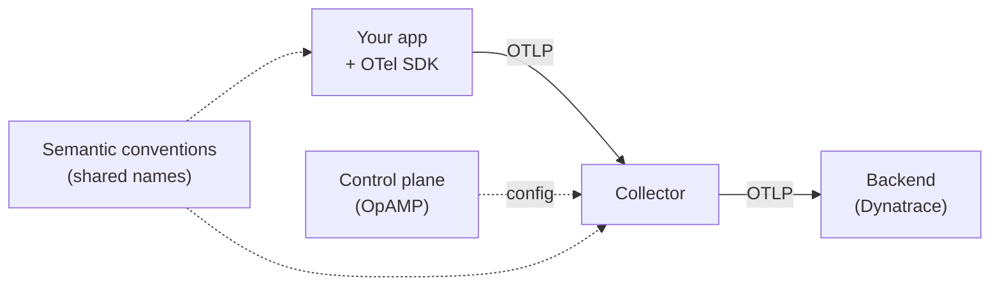
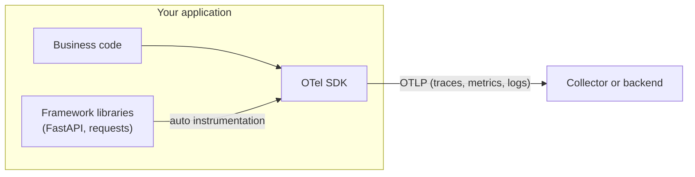
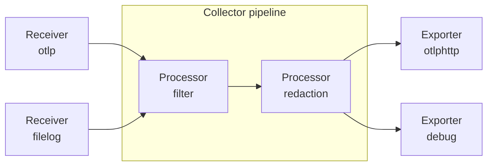
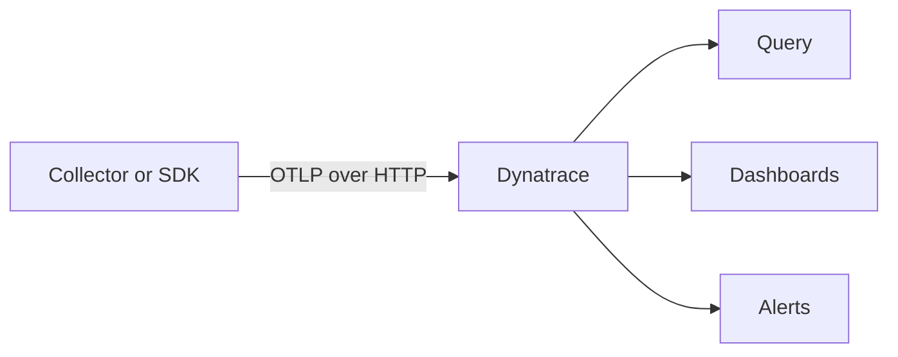
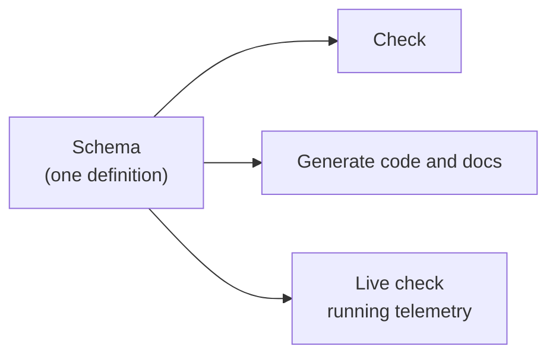
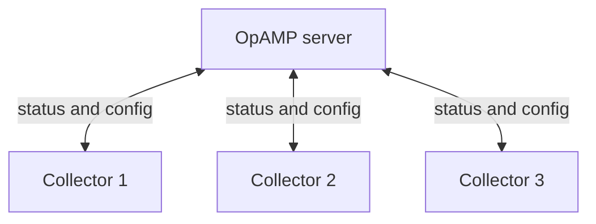

# OpenTelemetry concepts

This page is the reading version of the opening talk. It takes about 15 minutes.

**OpenTelemetry** (OTel) is an open source standard for making and moving telemetry. Telemetry is data that tells you what your software is doing.

We can see OTel as five ideas:

1. **Generate**: software creates telemetry.
2. **Collect and process**: telemetry is received, changed, and sent on.
3. **Store and analyse**: a backend keeps the data and helps you ask questions.
4. **Standardise**: everyone uses the same names for the same things.
5. **Control plane**: you manage many collectors from one place.

Here is the big picture. Each idea has its own section below.

## The three signals

A **signal** is a type of telemetry. OTel has three main signals:

| Signal | What it is | Example question |
|---|---|---|
| **Traces** | The path of one request through your system | Why was this request slow? |
| **Metrics** | Numbers measured over time | How many errors per minute? |
| **Logs** | Text records of events | What happened at 10:42:03? |

The signals are linked together. This is one of the key benefits of OTel. A log line carries the trace ID of the request that wrote it. A metric can point to an example trace. Then you can move from "something is wrong" to "this is the exact request".

## 1. Generate

Your code must produce telemetry first. In OTel, you do this with an **SDK** (software development kit). The SDK lives inside your application.

There are two ways to use it:

- **Auto instrumentation:** a library adds telemetry to common frameworks for you. You do not change your code. (Labs 01 and 02.)
- **Manual instrumentation:** you write code to add spans, attributes, and metrics that match your business. (Lab 03.)

The SDK sends data with an **exporter**. The most common exporter uses **OTLP**.

Not everything needs an SDK. Existing **Prometheus** metrics and plain **log** files can also feed into OTel, usually through the collector. (Labs 05 and 06.)

## 2. Collect and process

The **collector** is a separate program. It sits between your apps and your backend. It can:

- **Receive** data from many sources (OTLP, log files, host metrics, Prometheus).
- **Process** data: filter, redact secrets, sample, transform, and batch.
- **Export** data to one or more backends. It can route data to different places, or send the same data to several (multi-casting).

This is a **pipeline**: receivers, then processors, then exporters.

Why use a collector instead of sending straight from the app? These are the common reasons:

- You can change where data goes without changing app code.
- You can remove sensitive data in one place.
- You can cut volume and cost before data leaves your network.
- It can read data from things that cannot run an SDK, like log files. (Labs 05 and 06.)

A collector is also one more component to deploy, secure and operate. Sending straight from the app is simpler, and is a valid choice for small setups.

## 3. Store and analyse

The **backend** stores telemetry and lets you search it, chart it, and alert on it. OTel does not include a backend. This is on purpose. You can pick any tool that accepts OTLP.

In this workshop the backend is **Dynatrace**. It accepts OTLP over HTTP.

Because OTLP is an open standard, you can change backend later without re-instrumenting your code.

## 4. Standardise

Queries are much easier when names are the same everywhere. If one service writes `status`, another writes `http_code`, and a third writes `response.status`, you cannot write one query for all of them.

**Semantic conventions** are the shared names. For example:

| Meaning | Standard name |
|---|---|
| HTTP method | `http.request.method` |
| HTTP status code | `http.response.status_code` |
| URL path | `url.path` |
| Client IP address | `client.address` |

Standardisation goes beyond names. OTel also standardises the wire format (**OTLP**) and **context propagation**, so every language and tool can understand each other. (Lab 08.)

**Weaver** is a tool that helps your team define, check, and use these names. (Lab 09.)

## 5. Control plane

One collector is easy to manage. Thousands are not. You need a way to see them, send them new config, and upgrade them.

**OpAMP** (Open Agent Management Protocol) is the standard for this. Each collector connects to a server. The server can see its status and push new config. (Lab 10.)

## Where things sit

| Part | Where it runs | Job |
|---|---|---|
| SDK | Inside your app | Create telemetry and send it |
| Collector | Next to your app, or on its own host | Receive, process, export |
| Backend | Dynatrace | Store and analyse |
| Control plane | A central server | Manage collectors |

## Glossary

**Span**
:   One step of work, such as one HTTP request or one database call. It has a name, a start time, a duration, and attributes.

**Trace**
:   A group of spans that belong to one request. It shows the full path through your services.

**Attribute**
:   A key and value on a span, metric, or log. Example: `order.id = 42`.

**Signal**
:   A type of telemetry: traces, metrics, or logs.

**SDK**
:   The OTel code inside your app. It creates telemetry and sends it out.

**Instrumentation**
:   Code that makes telemetry. It can be automatic (a library) or manual (your own code).

**Collector**
:   A program that receives, processes, and exports telemetry.

**Receiver / processor / exporter**
:   The three parts of a collector pipeline. A receiver takes data in. A processor changes it. An exporter sends it out.

**Exporter**
:   The part that sends telemetry to another place. SDKs and collectors both have exporters.

**OTLP**
:   The OpenTelemetry Protocol. The standard way to send telemetry between SDKs, collectors, and backends.

**Context propagation**
:   Passing the trace ID from one service to the next, in a header, so spans join into one trace.

**Semantic convention**
:   A standard name for an attribute, such as `http.request.method`. It makes data the same across all services.

**OpAMP**
:   A protocol to manage many collectors from one server.

## Learn more

- [OpenTelemetry documentation](https://opentelemetry.io/docs/)
- [Semantic conventions](https://opentelemetry.io/docs/specs/semconv/)
