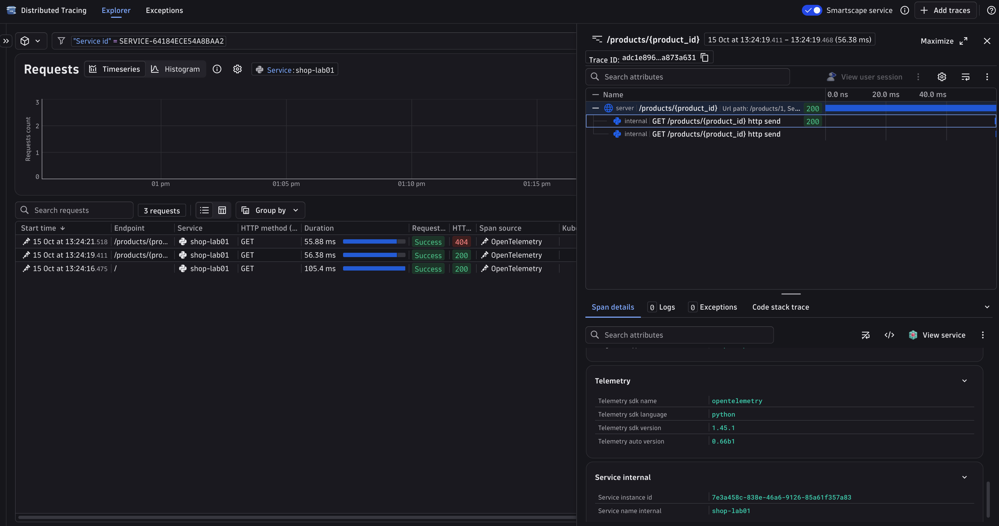

# Lab 01: Auto instrumentation

**Time: 15 minutes**

## Goal

Get traces from a Python web app with **zero code changes**. You will run an app that has no OpenTelemetry code, and still see spans.

## Why it matters

Auto instrumentation is the fastest way to start. In a few minutes you get HTTP spans, timings, and status codes. It is a good first step for any service. You will also see what it cannot know: your business.

## Steps

The lab files are in `labs/01-auto-instrumentation/`. The app (`app.py`) is a small FastAPI shop with two routes. It does not import OpenTelemetry. Open it and check.

1. Go to the lab folder:
   ```bash
   cd labs/01-auto-instrumentation
   ```
2. Turn on the virtual environment you made in [Setup](../setup.md#4-python-environment). It is in the repo root, so from this folder:

    === "macOS / Linux"

        ```bash
        source ../../.venv/bin/activate
        ```

    === "Windows (PowerShell)"

        ```powershell
        ..\..\.venv\Scripts\Activate.ps1
        ```

3. Check that the packages are installed. Read `requirements.txt` in the repo root. Among others, it has FastAPI, uvicorn, and two OpenTelemetry packages this lab uses:

    - `opentelemetry-distro` gives you the `opentelemetry-instrument` and `opentelemetry-bootstrap` commands.
    - `opentelemetry-exporter-otlp` can send data with OTLP.

4. Install the instrumentation libraries. `opentelemetry-bootstrap` looks at the packages in your environment and installs a matching instrumentation library for each one it knows (for example, FastAPI):
   ```bash
   opentelemetry-bootstrap -a install
   ```
   To see what it would install without installing, run:
   ```bash
   opentelemetry-bootstrap -a requirements
   ```
5. Tell OpenTelemetry what to do. You do this with **environment variables**, not code. Pick one:

    === "Dynatrace"

        Copy `.env.example` to `.env` in the repo root and fill it in. See [Setup](../setup.md). Then load it and set the variables:

        === "macOS / Linux"

            ```bash
            set -a; source ../../.env; set +a

            export OTEL_SERVICE_NAME="shop-lab01"
            export OTEL_TRACES_EXPORTER=console,otlp
            export OTEL_METRICS_EXPORTER=none
            export OTEL_LOGS_EXPORTER=none
            export OTEL_SEMCONV_STABILITY_OPT_IN=http
            export OTEL_EXPORTER_OTLP_PROTOCOL=http/protobuf
            export OTEL_EXPORTER_OTLP_ENDPOINT="$DT_ENDPOINT/api/v2/otlp"
            export OTEL_EXPORTER_OTLP_HEADERS="Authorization=Api-Token $DT_API_TOKEN"
            ```

        === "Windows (PowerShell)"

            ```powershell
            Get-Content ..\..\.env | ForEach-Object { if ($_ -match '^\s*([^#=\s][^=]*)=(.*)$') { Set-Item "env:$($Matches[1].Trim())" $Matches[2].Trim().Trim('"') } }

            $env:OTEL_SERVICE_NAME = "shop-lab01"
            $env:OTEL_TRACES_EXPORTER = "console,otlp"
            $env:OTEL_METRICS_EXPORTER = "none"
            $env:OTEL_LOGS_EXPORTER = "none"
            $env:OTEL_SEMCONV_STABILITY_OPT_IN = "http"
            $env:OTEL_EXPORTER_OTLP_PROTOCOL = "http/protobuf"
            $env:OTEL_EXPORTER_OTLP_ENDPOINT = "$env:DT_ENDPOINT/api/v2/otlp"
            $env:OTEL_EXPORTER_OTLP_HEADERS = "Authorization=Api-Token $env:DT_API_TOKEN"
            ```

    === "Console (no tenant)"

        Print spans in the terminal:

        === "macOS / Linux"

            ```bash
            export OTEL_SERVICE_NAME="shop-lab01"
            export OTEL_TRACES_EXPORTER=console
            export OTEL_METRICS_EXPORTER=none
            export OTEL_LOGS_EXPORTER=none
            export OTEL_SEMCONV_STABILITY_OPT_IN=http
            ```

        === "Windows (PowerShell)"

            ```powershell
            $env:OTEL_SERVICE_NAME = "shop-lab01"
            $env:OTEL_TRACES_EXPORTER = "console"
            $env:OTEL_METRICS_EXPORTER = "none"
            $env:OTEL_LOGS_EXPORTER = "none"
            $env:OTEL_SEMCONV_STABILITY_OPT_IN = "http"
            ```

    | Variable | Meaning |
    |---|---|
    | `OTEL_SERVICE_NAME` | The name of your service in the backend |
    | `OTEL_TRACES_EXPORTER` | `console` prints spans. `otlp` sends them with OTLP. |
    | `OTEL_METRICS_EXPORTER`, `OTEL_LOGS_EXPORTER` | `none`: this lab only uses traces |
    | `OTEL_SEMCONV_STABILITY_OPT_IN` | `http` gives the stable attribute names |
    | `OTEL_EXPORTER_OTLP_PROTOCOL` | `http/protobuf` is what Dynatrace accepts |
    | `OTEL_EXPORTER_OTLP_ENDPOINT` | Where to send data: `<your tenant>/api/v2/otlp` |
    | `OTEL_EXPORTER_OTLP_HEADERS` | The token, so Dynatrace accepts the data |

6. Start the app **with the agent in front of it**. Without `opentelemetry-instrument`, this is a normal app with no telemetry:
   ```bash
   opentelemetry-instrument uvicorn app:app --port 8000
   ```
   `opentelemetry-instrument` starts your command. Before your app code runs, it turns on every instrumentation library it finds, and it sets up the SDK from the environment variables.
7. In a second terminal, send some requests:

    === "macOS / Linux"

        ```bash
        curl localhost:8000/
        curl localhost:8000/products/1
        curl localhost:8000/products/99
        ```

    === "Windows (PowerShell)"

        Type `curl.exe`. In PowerShell, plain `curl` is a different command.

        ```powershell
        curl.exe localhost:8000/
        curl.exe localhost:8000/products/1
        curl.exe localhost:8000/products/99
        ```

8. Look at the spans. In console mode, they print in the first terminal. In Dynatrace, open **Distributed Tracing** and filter by service `shop-lab01`.

!!! tip "New terminal?"
    Environment variables and the virtual environment belong to one terminal. If you open a new one, activate the environment and set the variables from step 5 again:

    === "macOS / Linux"

        ```bash
        source ../../.venv/bin/activate
        ```

    === "Windows (PowerShell)"

        ```powershell
        ..\..\.venv\Scripts\Activate.ps1
        ```

### Token scopes

For this lab, the Dynatrace API token needs the scope `openTelemetryTrace.ingest`. The later labs also send metrics and logs, so we ask for all three:

- `openTelemetryTrace.ingest`
- `metrics.ingest`
- `logs.ingest`

Source: [Dynatrace OTLP export docs](https://docs.dynatrace.com/docs/ingest-from/opentelemetry/getting-started/otlp-export).

## Expected result

For each request you see one **server span** named like `GET /products/{product_id}`. FastAPI also adds small child spans for the ASGI `send` events.

Here are the important attributes on the server span:

| Attribute | Example | Meaning |
|---|---|---|
| `http.request.method` | `GET` | The HTTP method |
| `url.path` | `/products/1` | The path that was called |
| `http.route` | `/products/{product_id}` | The route pattern (low cardinality) |
| `http.response.status_code` | `200` | The result |
| `client.address` | `127.0.0.1` | Who called |
| `user_agent.original` | `curl/8.7.1` | The client program |



In Dynatrace, the list shows one row per request. Open one to see the server span and its two small `http send` child spans. Note the `404` row: Dynatrace shows it as `Success`, because a 4xx is not a server failure.

### What you got for free

- A span for every HTTP request, with timing.
- Standard attributes: method, path, route, status, client.
- Context propagation: if another service calls this one with a `traceparent` header, the spans join its trace. (Lab 02.)

### What you did not get

- Anything about your business. Which product? How much did it cost? Which customer?
- The `404` request has status `UNSET`, not `ERROR`. For a server, a 4xx is the client's mistake, so OTel does not mark it as an error.
- Any detail inside the function. The 50 ms of "work" is just part of the one span.

Lab 03 shows how manual instrumentation adds this.

## Stuck?

- **`python: command not found` or `No module named venv`:** install Python 3.11 or newer. See [Setup](../setup.md).
- **`opentelemetry-instrument: command not found`:** the virtual environment is not on (see [Setup](../setup.md#4-python-environment)). Turn it on: `source ../../.venv/bin/activate` (macOS / Linux) or `..\..\.venv\Scripts\Activate.ps1` (Windows PowerShell).
- **Port 8000 is busy** (for example, `mkdocs serve` also uses it): stop the other program, or use another port, such as `--port 8001`. Then use the same port in the `curl` commands.
- **Nothing in Dynatrace, no errors:** wait 30 seconds. Check that `DT_ENDPOINT` has no `/api/...` at the end. Step 5 adds `/api/v2/otlp`.
- **401 or 403 from Dynatrace:** the token is wrong or lacks the `openTelemetryTrace.ingest` scope.
- **Console output is not showing:** the console exporter writes in batches. Wait about 5 seconds after a request. Also check that you sent a request (nothing prints at startup) and that `OTEL_TRACES_EXPORTER` is set in the same terminal that runs the app (`echo $OTEL_TRACES_EXPORTER` should print `console`). If it is unset, the default is `otlp`, which tries `localhost:4318` and prints nothing.

## Going further

- Remove `OTEL_SEMCONV_STABILITY_OPT_IN` and run again. The attribute names change (`http.method`, `http.status_code`). These are the old names. Standard names are the topic of Lab 08.
- Send to both console and Dynatrace. Use the **Dynatrace** settings from step 5, but set `OTEL_TRACES_EXPORTER` to `console,otlp` (`export OTEL_TRACES_EXPORTER=console,otlp` on macOS / Linux, `$env:OTEL_TRACES_EXPORTER = "console,otlp"` on Windows). Spans print in the terminal and also arrive in Dynatrace over OTLP HTTP (`http/protobuf`).
