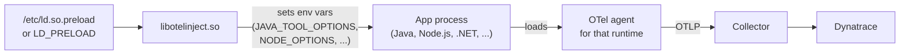

# Lab 04: OpenTelemetry Injector (discussion)

**Time:** 10 minutes. Discussion only, no lab.

## 1. Goal

Understand what the OpenTelemetry Injector is, how it adds instrumentation without code changes, and where it fits next to the approaches from Labs 01 to 03.

## 2. Why it matters

In Labs 01 and 02 you started the app with `opentelemetry-instrument`. That still means you change how each app starts. On a host with 200 services, this is a lot of work.

The OpenTelemetry Injector solves this. You install it once on a host, and it switches on auto instrumentation for the processes on that host. You do not edit each service's start command.

The injector does not collect any telemetry itself. It only helps the OTel auto instrumentation agent for each runtime (for example the Java agent) load into your processes. You still need those agents.

If you know the Dynatrace OneAgent, the "install once per host" idea is the same. Put together, the pieces form an open source alternative:

- the **injector** gets the agents loaded,
- the **OTel agents** for each runtime create the telemetry,
- the **collector** receives it and sends it to your backend.

This is a viable approach, but it is early. It is not a drop-in OneAgent. You assemble and maintain the parts yourself, and the injector is still `0.x`. It supports Linux only, and Python is off by default. The OneAgent also comes with vendor support, which this setup does not. See section 5 for the full list of limits.

## 3. How it works

The injector is a small shared library (`libotelinject.so`), written in Zig. It does **not** instrument your code. It only sets environment variables, so that the real OTel agent for your runtime loads.

1. A Linux process starts. The dynamic linker loads the injector first, because of `LD_PRELOAD` or `/etc/ld.so.preload`.
2. The injector finds the process's C library (glibc or musl).
3. It uses the library to read and write the process environment.
4. It adds variables such as `JAVA_TOOL_OPTIONS`, `NODE_OPTIONS`, `RUBYOPT` or `CORECLR_PROFILER`. These point to the auto instrumentation agent for that runtime.
5. The app starts. The runtime sees these variables and loads the agent. The agent sends OTLP to your collector.

If any step fails, the injector stops and lets the process start as normal.

Two things to notice:

- `/etc/ld.so.preload` affects **every** process on the host. `LD_PRELOAD` affects only one process.
- The injector can also set resource attributes, such as `service.name` and Kubernetes pod names. It reads them from `OTEL_INJECTOR_*` variables.

## 4. What it supports

Checked against the [upstream README](https://github.com/open-telemetry/opentelemetry-injector) (latest release at the time of writing: v0.11.0, August).

| Topic | Status |
|---|---|
| Runtimes | Java, Node.js, .NET, Ruby. Python is **off by default**. |
| Operating system | Linux only (it relies on ELF and the dynamic linker). |
| C library | glibc and musl. If it cannot find the libc, it does not inject. |
| .NET | Only .NET 8 or newer by default. It skips apps that already reference `OpenTelemetry*` packages. |
| Installation | DEB and RPM packages come from [opentelemetry-packaging](https://github.com/open-telemetry/opentelemetry-packaging). The injector repository only publishes the raw `.so`. |
| Config file | `/etc/opentelemetry/injector/injector.conf` sets the agent path for each runtime. |
| Filtering | `include_paths`, `exclude_paths`, `include_with_arguments`, `exclude_with_arguments`. Exclusions win. |
| Opt out | `OTEL_INJECTOR_DISABLED=true` for one workload. `auto_instrumentation_disabled=*` for all. |

!!! note "Python is off by default"
    The README says it is not always safe to add Python packages to a process, because of possible dependency conflicts. This is why our Python labs use `opentelemetry-instrument` and a pinned `requirements.txt` instead.

## 5. Limits and security notes

**Limits**

- Linux only. No Windows, and no macOS.
- It is young. Releases are still `0.x`, and the README gives no stability label. Expect changes. For example, v0.10.0 removed DEB and RPM builds from the repository.
- It does not create the agents. You must install the agent for each runtime, or use the packages that bundle them.
- By default it only sets variables that start with `OTEL_`. Other prefixes need a custom build.
- For .NET it overwrites existing profiler variables. .NET does not support two agents.
- Auto instrumentation gives you framework spans only. It does not know your business logic. Business-level spans need manual instrumentation, as in Lab 03.

**Security**

- Turning it on for the whole host needs root.
- A preloaded library runs inside **every** process, with that process's permissions. It carries the same risks as any code that runs on production hosts.
- Raw library releases are signed with Sigstore Cosign. The README says to verify the signature before loading the file: "If verification fails, do not load the artifact."
- A bug in the injector can affect the host process. Release v0.10.1 fixed a crash on older glibc. Many teams test on a staging host first.
- Injected agents change what data leaves the host. Check which attributes they capture.

## 6. Discussion questions

1. You have 200 Java services on VMs. What are the pros and cons of the injector compared with adding `-javaagent` to each start script?
2. `/etc/ld.so.preload` affects every process. When would you rather use `LD_PRELOAD` for one service?
3. The injector is `0.x`. What would you need to see before you use it in production? (Think: tests, signing, release process, who maintains it.)
4. Your team runs Python services. The injector leaves Python off by default. What would you do instead?
5. How is this different from the Dynatrace OneAgent? Think about scope, support, and what happens when something breaks.
6. In Kubernetes, you could use the OpenTelemetry Operator to inject agents. When would a host-level injector still be useful?

## 7. Going further

- [OpenTelemetry Injector on GitHub](https://github.com/open-telemetry/opentelemetry-injector)
- [OpenTelemetry packaging (DEB and RPM)](https://github.com/open-telemetry/opentelemetry-packaging)
- Read the README sections "Design" and "Configuration" to see every setting.
