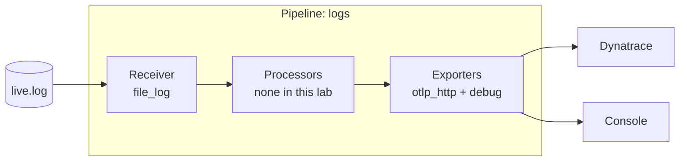

# Lab 05: Collector basics

**Time: 20 minutes**

## Goal

Run an OpenTelemetry Collector that reads a log file and sends the lines to Dynatrace. Then send the telemetry of your Lab 03 app through the same collector.

## Why it matters

So far, every app sent data straight to Dynatrace. That works for a lab. Many setups put one component between the apps and the backend. The **collector** is that component. It can read files, receive data from apps, change data, and send it to one or more backends. Your apps do not need to change when the backend changes.

## How a collector works

A collector is a set of **pipelines**. Each pipeline handles one signal (logs, metrics or traces) and has three kinds of parts:



| Part | Job | In this lab |
|---|---|---|
| **Receiver** | Gets data in | `file_log` reads a file |
| **Processor** | Changes data on the way (filter, mask, batch) | Next lab |
| **Exporter** | Sends data out | `otlp_http` to Dynatrace, `debug` to the console |
| **Pipeline** | Connects them in the `service:` section | One `logs` pipeline |

A component that is **defined** but not listed in a pipeline does nothing.

## Which collector image?

| Component | Dynatrace distro `0.58.0` | Upstream contrib `0.162.0` |
|---|:---:|:---:|
| `file_log` receiver | yes | yes |
| `otlp` receiver | yes | yes |
| `host_metrics` receiver | yes | yes |
| `prometheus` receiver | yes | yes |
| `filter` processor | yes | yes |
| `transform` processor | yes | yes |
| `redaction` processor | yes | yes |
| `log_dedup` processor | **no** | yes |
| `otlp_http` exporter | yes | yes |
| `debug` exporter | yes | yes |
| `opamp` extension | **no** | yes |
| Image size on disk | 220 MB | 482 MB |
| Image size compressed | 45 MB | 103 MB |

The table comes from running `components` on both images. You can repeat it:

```bash
docker run --rm ghcr.io/dynatrace/dynatrace-otel-collector/dynatrace-otel-collector:0.58.0 components
```

To see the sizes on your machine, pull the images and list them:

```bash
docker images | grep -E "dynatrace-otel-collector|opentelemetry-collector-contrib"
```

**DISK USAGE** is the unpacked size on your machine. **CONTENT SIZE** is the compressed size, close to what you download from a registry.

Both images are big, because they contain many components you will never use. Can we ship only the parts we need? Yes. In [Lab 07](07-ocb.md) you build your own collector that is a fraction of this size.

**This lab uses the Dynatrace distro**, because it has every component we need and it is smaller. **Lab 06 uses contrib**, because it needs `log_dedup`.

!!! note "Component names"
    In these versions, component names use an underscore: `file_log`, `otlp_http`, `log_dedup`. Older guides write `filelog`, `otlphttp`, `logdedup`. If you copy a config from the internet, check the names.

## Steps

The lab files are in `labs/05-collector-basics/`. Docker must be running.

1. Go to the lab folder and create the file the collector will read:
   ```bash
   cd labs/05-collector-basics
   touch live.log
   ```
2. Look at `collector.yaml`. It has one receiver, two exporters and one pipeline:
   ```yaml
   receivers:
     file_log:
       include: [/logs/live.log]
       start_at: beginning
   exporters:
     otlp_http/dynatrace:
       endpoint: ${env:DT_ENDPOINT}/api/v2/otlp
       headers:
         Authorization: "Api-Token ${env:DT_API_TOKEN}"
     debug:
       verbosity: basic
   service:
     pipelines:
       logs:
         receivers: [file_log]
         exporters: [otlp_http/dynatrace, debug]
   ```
   - `${env:NAME}` reads an environment variable. Your token stays out of the file.
   - The collector adds `/v1/logs` to the endpoint by itself.
   - `otlp_http/dynatrace` is a **named instance**: `type/name`. You can have many exporters of the same type.
3. Check that the config is valid. This is the same check you would run in a build pipeline:
   ```bash
   docker run --rm \
     -e DT_ENDPOINT=https://example.live.dynatrace.com -e DT_API_TOKEN=x \
     -v "$PWD/collector.yaml:/c.yaml:ro" \
     ghcr.io/dynatrace/dynatrace-otel-collector/dynatrace-otel-collector:0.58.0 \
     validate --config=/c.yaml
   ```
   No output means the config is valid.
4. Start the collector:
   ```bash
   docker compose --env-file ../../.env up
   ```

    ??? note "No Dynatrace tenant? Print the logs in the console"
        ```bash
        docker compose -f docker-compose.yaml -f docker-compose.console.yaml up
        ```
        This uses `collector.console.yaml`: the same pipeline without the Dynatrace exporter. The debug exporter prints every log line in full.

5. Open a **second terminal**, go to the same folder, and start a program that writes one log line per second. It repeats the lines of `sample.log`:
   ```bash
   python3 append_logs.py
   ```
6. Watch the first terminal. Each `log records: 1` line is one log line that was read and exported.
7. Open Dynatrace, open the **Logs** app, and filter with `content = *"order-service"*`. Your lines appear after a few seconds.

Stop the program with `Ctrl+C`. Stop the collector with `Ctrl+C`, then run `docker compose down`.

## Expected result

In the collector terminal:

```text
info  Logs  {"otelcol.component.id": "debug", "otelcol.signal": "logs", "log records": 1}
```

In Dynatrace, log lines like these:

```text
INFO order-service GET /api/orders/48214 status=200 duration_ms=142
WARN payment-service Connection reset by peer while calling downstream billing-api
INFO account-service password reset for uid=jsmith email=john.smith999@gmail.com
```

!!! warning "Look at that last line"
    It contains an email address. The collector sent it to Dynatrace without a question. The next lab fixes this.

<!-- TODO: screenshot of the log lines in the Dynatrace Logs app. Save as docs/assets/lab05-logs.png and link it here. -->

*Screenshot placeholder: the Dynatrace Logs app with the `order-service` lines.*

## Other receivers

The file is one way to get data in. A few more that the Dynatrace distro includes:

| Receiver | Gets | Use it for |
|---|---|---|
| `otlp` | Traces, metrics, logs from apps | Your instrumented apps (next exercise) |
| `host_metrics` | CPU, memory, disk, network | Machine health |
| `prometheus` | Metrics from `/metrics` endpoints | Apps that already expose Prometheus metrics |

These are only a few. There are many more receivers for all kinds of cloud platforms and technologies (databases, message queues, Kubernetes, AWS, Azure, GCP and more). Browse the full list in the [OpenTelemetry Collector contrib repository](https://dt-url.net/otel-receivers).

### Exercise: send the Lab 03 app through the collector

Now the collector also receives OTLP. We add an `otlp` receiver and a pipeline for each signal (`collector.otlp.yaml`).

1. Stop the collector from the steps above (`docker compose down`).
2. Start it again with the extra config. It publishes port `4318` (OTLP over HTTP) to your machine:
   ```bash
   docker compose --env-file ../../.env -f docker-compose.yaml -f docker-compose.otlp.yaml up
   ```
3. In a second terminal, start Lab 03 and point it at the collector instead of Dynatrace. The file `docker-compose.collector.yaml` only changes the endpoint:
   ```bash
   cd ../03-manual-instrumentation
   docker compose --env-file ../../.env -f docker-compose.yaml -f docker-compose.collector.yaml up --build
   ```
   The apps run in containers. They reach the collector on your machine at `host.docker.internal`.
4. Send an order:
   ```bash
   curl "localhost:9000/order/1?quantity=2"
   ```
5. In the collector terminal, you see `traces`, `metrics` and `logs`. In Dynatrace, you see the same trace as in Lab 03.

The app did not change. Only one environment variable changed: `OTEL_EXPORTER_OTLP_ENDPOINT`. Now you can filter, mask or route this data in one place.

## Stuck?

- **`unsupported protocol scheme ""` in the collector output:** you forgot `--env-file ../../.env`, or `.env` is empty.
- **`401` or `403` in the collector output:** the token has no `logs.ingest` scope. See [Setup](../setup.md).
- **`404` from Dynatrace:** the endpoint must be the base URL, like `https://abc12345.live.dynatrace.com`. No `/api/v2/otlp` and no trailing slash in `.env`. The config adds the path.
- **No log lines in the collector:** check that `append_logs.py` runs in the lab folder, and that `live.log` exists *before* you start the collector. On Linux, check the file permissions.
- **`unknown type: "filelog"`:** the name is `file_log` in this version.
- **Lab 03 cannot reach the collector (Linux):** the override file adds `host.docker.internal` for you. Check that the collector container is running and port `4318` is free.
- **Port `4318` is in use:** another collector or app uses it. Stop it.

## Going further

- Add the `host_metrics` receiver and a `metrics` pipeline. What do you see?
- Change `verbosity: basic` to `detailed` in the `debug` exporter. What attributes does the `file_log` receiver add?
- Add the `batch` processor to the pipeline. Many production collectors use it. What does it do, and what trade-offs does it bring?
