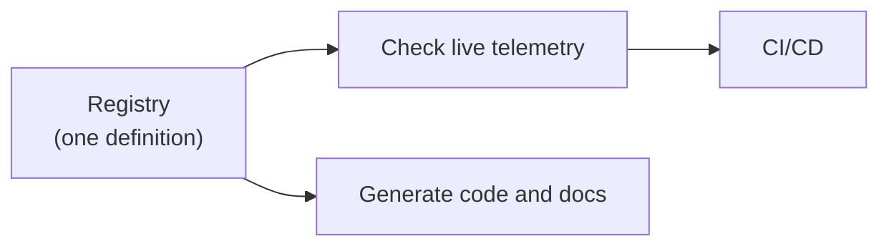

# Lab 09: Weaver

**Time: 20 minutes**

## Goal

Define your own semantic convention. Then use **Weaver** to check live telemetry against it, and see what a good, a bad and a wrong record look like.

## Why it matters

A list of names in a wiki does not work. Nobody reads it, and nobody checks it. **Weaver** is an OpenTelemetry tool that turns the names into a **schema** (a registry) that a machine can read. With one schema you can:

- **check** that telemetry follows the rules (we do this in this lab)
- **generate** documentation and code
- run the check in a **CI/CD pipeline**, so bad telemetry never reaches production



## The story

We work for `ACME Corporation`. Finance says: **every log record must have an attribute `acme.cost.code`**, so they can charge the cost to the right team. The format is three capital letters and four digits, for example `ABC1234`.

## The files

The lab files are in `labs/09-weaver/`.

| File | What it does |
|---|---|
| `model/manifest.yaml` | Names our registry (`acme`). It also imports the standard OpenTelemetry conventions, so we check against both. |
| `model/imports.yaml` | Says "import everything" from the OpenTelemetry registry. |
| `model/cost.yaml` | Defines the new attribute `acme.cost.code` with a description and examples. |
| `policies/cost_code.rego` | Two rules: the **value** must match `^[A-Z]{3}[0-9]{4}$`, and every log must **have** the attribute. |
| `emit_test_logs.py` | Sends 3 test logs to Weaver. |

!!! note "The registry and the policy do different jobs"
    `cost.yaml` says the key **exists** and what it means. The descriptions and examples are for humans. The **format** of the value is checked by the policy in `cost_code.rego` (written in a language called Rego). Weaver does not read the regex from the YAML.

## Steps

Docker must be running. You need Python 3.11+.

1. Go to the lab folder, create a Python environment and pull the Weaver image:
   ```bash
   cd labs/09-weaver
   python3 -m venv .venv
   source .venv/bin/activate
   pip install -r requirements.txt
   docker pull otel/weaver:v0.28.0
   ```
2. Check that the registry is valid:
   ```bash
   docker run --rm -v "$(pwd)":/work -w /work otel/weaver:v0.28.0 registry check -r /work/model
   ```
   You should see `✔ No after_resolution policy violation`. Weaver downloads the OpenTelemetry conventions the first time, so this can take a few seconds.
3. Open **two terminals** in `labs/09-weaver`. In **terminal 1**, start Weaver in `live-check` mode. It is a server that waits for telemetry on port 4317 and checks every record. It stops after 30 seconds without data:
   ```bash
   docker run --rm -v "$(pwd)":/work -w /work -p 4317:4317 -p 4320:4320 otel/weaver:v0.28.0 \
     registry live-check -r /work/model --advice-policies /work/policies \
     --otlp-grpc-address 0.0.0.0 --inactivity-timeout 30
   ```
   Wait until you see `OTLP gRPC listener started`.
4. In **terminal 2**, activate the environment (`source .venv/bin/activate`) and send the 3 test logs:
   ```bash
   python emit_test_logs.py
   ```
5. Go back to terminal 1. Wait for Weaver to stop, or press `Ctrl+C`. It prints a report.

??? note "On Windows?"
    Use PowerShell and replace `$(pwd)` with `${PWD}`, and `source .venv/bin/activate` with `.venv\Scripts\activate`.

## Expected result

Weaver prints one block per log. Read the `Log` part of each block. Colours in the terminal: green is fine, red is a violation.

**Log 1: `good`** is compliant. Every attribute is green.

```text
Log
    acme.cost.code = ABC1234
```

**Log 2: `bad-format`** has the right key, but a wrong value:

```text
Log
    acme.cost.code = abc-12
        - [violation] acme.cost.code value 'abc-12' does not match ^[A-Z]{3}[0-9]{4}$
```

**Log 3: `wrong-key`** has the right value, but the wrong key. Two violations: the key is not in the registry, and the required key is missing:

```text
Log
    - [violation] Log record is missing required attribute 'acme.cost.code'
    cost-code = ABC1234
        - [violation] Attribute 'cost-code' does not exist in the registry.
```

At the end is a summary. We got **3 violations** (one per bad log) and 3 `improvement` messages:

```text
Advisories given
  - total: 6
  - advice level:
    - improvement: 3
    - violation: 3
```

!!! info "What are the 3 improvements?"
    Each log also has `service.instance.id`, which the SDK adds. In this OpenTelemetry version it is not `stable` yet, so Weaver says so. It is only advice. You can ignore it.

Weaver has levels: `violation` (must fix), `improvement` (should fix) and `information` (FYI). You choose the level in your policy.

<!-- TODO: screenshot of Weaver live-check output. Save as docs/assets/lab09-weaver.png and link it here. -->

*Screenshot placeholder: the Weaver report with one green log and two logs with violations.*

## Exercise: add an enum attribute

ACME also wants an attribute `acme.environment`. Only two values are allowed: `prod` and `staging`.

1. Add this to the end of `model/cost.yaml`, under `attributes:` (keep the indentation: it lines up with `- id: acme.cost.code`):
   ```yaml
         - id: acme.environment
           type:
             members:
               - id: production
                 value: prod
                 stability: stable
               - id: staging
                 value: staging
                 stability: stable
           stability: stable
           brief: Environment the telemetry came from.
           examples: ["prod", "staging"]
   ```
2. Check the registry again (step 2).
3. In `emit_test_logs.py`, change the `good` and `bad-format` lines to:
   ```python
   "good": ("team-a", {"acme.cost.code": "ABC1234", "acme.environment": "prod"}),
   "bad-format": ("team-b", {"acme.cost.code": "abc-12", "acme.environment": "production"}),
   ```
4. Run Weaver (step 3), then send the logs (step 4).

You should see that `acme.environment = prod` is clean, and for `production` Weaver says:

```text
acme.environment = production
    - [information] Enum attribute 'acme.environment' has value 'production' which is not documented.
```

An enum is checked by Weaver **without** a policy. You only had to define it. Notice the level is `information`, not `violation`. To make it a hard failure, you would write a Rego rule like the one in `cost_code.rego`.

## Weaver in a pipeline

Weaver can write its report as JSON or YAML (`--output`), so a CI/CD job can read it. A team could run their tests with Weaver in `live-check` mode, and fail the build on any `violation`. See `weaver registry live-check --help`.

## Stuck?

- **`Cannot connect to the Docker daemon`:** start Docker.
- **`port is already allocated` (4317):** a collector from another lab is running. Run `docker compose down` in that lab's folder.
- **The Python script prints errors about the connection:** Weaver is not ready yet. Wait for `OTLP gRPC listener started`, then run it again.
- **Weaver stops before you send logs:** the 30 second timeout ran out. Start it again.
- **`registry check` fails with a YAML error:** indentation. Use spaces, not tabs. The new attribute must line up with the first one.
- **No difference after you edit the registry:** Weaver reads `model/` when it starts. Stop it and start it again.
- **`ModuleNotFoundError: opentelemetry`:** you did not activate the environment in terminal 2.

## Going further

- Add a Rego rule that makes an unknown `acme.environment` value a `violation`.
- Point Weaver at a real app: send the OTLP data from [Lab 03](03-manual-instrumentation.md) to port 4317. Which of your custom attributes (`order.id`, `shop.orders`) are not in any registry?
- Read the [Weaver docs](https://github.com/open-telemetry/weaver) and the [original hands-on repo](https://github.com/agardnerIT/otel-weaver-hands-on). It also checks plain-text logs coming from a collector `filelog` receiver. Why do you think the plain-text log fails the check?
