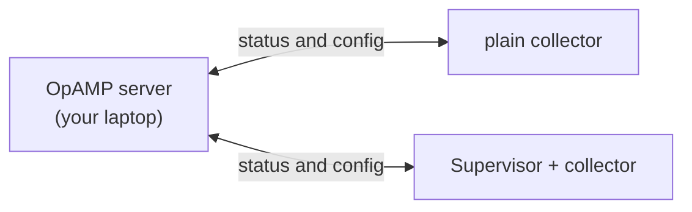

# Lab 10: OpAMP

**Time: 20 minutes**

## Goal

Run a small **OpAMP server**, connect two collectors to it, then change the config of a running collector by editing one file on the server. You never touch the collector.

## Why it matters

One collector is easy to manage. A thousand are not. You need to answer: which collectors exist, are they healthy, and what config do they run? You also need to change that config without logging in to each machine.

**OpAMP** (Open Agent Management Protocol) is the standard for this. Each collector (the **agent**) connects to a **server**. The agent reports who it is, its health and its config. The server can send back new config.



OpAMP messages use **protobuf**, a compact binary format. It is like JSON, but the bytes carry only field *numbers*, not names. A shared `.proto` file says what each number means. The folder `labs/10-opamp/opamp/v1/` holds Python code generated from the OpAMP `.proto` files, so the server can read and write the messages. You do not need to run anything to make it.

## The scenario

A collector tails a log file. As is normal in production, it **drops DEBUG logs** to save cost and noise. Then there is an **incident**, and you need the DEBUG detail now. You will edit a file on the server, and the DEBUG lines will start to flow. When the incident ends, you revert it.

## The files

The lab files are in `labs/10-opamp/`.

| File | What it does |
|---|---|
| `server.py` | The OpAMP server. It lists agents, watches `remote-config.yaml` and pushes it to agents. |
| `remote-config.yaml` | **The file the server watches.** Whatever is in it is what agents are told to run. |
| `examples/baseline.yaml` | Normal state: keep the local filter, so DEBUG is dropped. |
| `examples/capture-debug.yaml` | Incident state: remove the filter, so DEBUG is kept. |
| `docker-compose.yaml` | Two agents: `plain` and `agent`. |
| `agent/collector.yaml` | The collector's **local** config: tail `logs/file.log`, read the level, drop DEBUG, print the rest. |
| `agent/supervisor.yaml` | Tells the Supervisor where the server is and that it accepts remote config. |

!!! note "Why does the second agent need a Supervisor?"
    A collector's own `opamp` extension reports status, health and config. It **cannot change the collector it lives in**. That job belongs to the **OpAMP Supervisor**. It keeps the OpAMP connection, starts the collector as a child process, **merges** the remote config with the local config, and restarts the collector. So agent 2 is a Supervisor and a collector in one container.

## Steps

Docker must be running. You need three terminals, all in the lab folder. The server runs on your machine and uses the Python environment from [Setup](../setup.md#4-python-environment).

### Part 1: Run the server and see an agent

1. **Terminal 1.** Start the server:
   ```bash
   cd labs/10-opamp
   source ../../.venv/bin/activate
   python server.py
   ```
   It prints `* remote-config.yaml changed (...)`. It has read the file and is waiting for agents.
2. **Terminal 2.** Start the plain collector:
   ```bash
   cd labs/10-opamp
   docker compose up -d plain
   ```
3. Within a few seconds, terminal 1 prints `+ agent <id> connected`. List what the server knows:
   ```bash
   curl -s localhost:4320/agents | python3 -m json.tool
   ```
   You see the agent's `description` (name, version, host), its health, and its `capabilities`. The capabilities are sent as one number (a bitmask, one bit per yes/no ability). The server turns it into names.

   Look at the list. There is **no** `AcceptsRemoteConfig`. This agent can report, but it cannot be told what to do.

### Part 2: Connect an agent that accepts config

4. Start the Supervisor agent (the first build takes about a minute):
   ```bash
   docker compose up -d --build agent
   ```
5. Terminal 1 shows the server sending the file and the agent applying it:
   ```text
   + agent 01a1438afaae7bac9c2097c7ac1990f9 connected
   > agent 01a1438afaae7bac9c2097c7ac1990f9: sending remote-config.yaml
   ~ agent 01a1438afaae7bac9c2097c7ac1990f9 remote config APPLIED
   ```
   You see this once at start, even though the config equals the local one. The server sends the file to any agent that accepts it, as soon as it connects. Run `curl` again. Now there are two agents, and only one has `AcceptsRemoteConfig` and `remote_config_status: APPLIED`.
6. **Terminal 3.** Watch what the collector prints, as just `LEVEL message`:
   ```bash
   cd labs/10-opamp
   source ../../.venv/bin/activate
   docker compose logs -f --no-log-prefix agent | python3 watch_collector.py
   ```
   The three DEBUG lines already in the log file are dropped, so you see nothing yet. That is the production baseline.

### Part 3: The incident

7. In terminal 2, write two log lines. One is INFO, one is DEBUG:
   ```bash
   echo "INFO user logged in" >> logs/file.log
   echo "DEBUG cache miss"    >> logs/file.log
   ```
   Terminal 3 shows only `INFO   user logged in`. The DEBUG line is dropped.
8. **Incident! Turn on DEBUG capture.** Open `examples/capture-debug.yaml`. It removes the filter from the logs pipeline:
   ```yaml
   service:
     pipelines:
       logs:
         processors: []
   ```
   Lists are **replaced** when configs merge, so an empty list removes the local `filter/drop_debug`. Copy it over the watched file:
   ```bash
   cp examples/capture-debug.yaml remote-config.yaml
   ```
   On Windows PowerShell, use `copy examples\capture-debug.yaml remote-config.yaml`. You can also paste it into `remote-config.yaml` in your editor and save.
9. Terminal 1 shows the full round trip:
   ```text
   * remote-config.yaml changed (3ddcc841)
   > agent 01a1438a...: pushed remote-config.yaml
   ~ agent 01a1438a... remote config APPLYING
   ~ agent 01a1438a... remote config APPLIED
   ```
10. Write more logs:
    ```bash
    echo "INFO payment failed"          >> logs/file.log
    echo "DEBUG retrying gateway call"  >> logs/file.log
    ```
    This time terminal 3 shows **both** lines.
11. Ask the server what the collector is really running. Use the `instance_uid` of the agent with `APPLIED`:
    ```bash
    curl -s localhost:4320/agents/<instance_uid>/effective-config
    ```
    The `logs` pipeline now has no `filter/drop_debug`.
12. **Incident over.** Revert:
    ```bash
    cp examples/baseline.yaml remote-config.yaml
    echo "DEBUG should be dropped again" >> logs/file.log
    ```
    The DEBUG line no longer appears in terminal 3.
13. Clean up. Press `Ctrl-C` in terminal 1 and in terminal 3, then run:
    ```bash
    docker compose down
    cp examples/baseline.yaml remote-config.yaml
    printf 'DEBUG starting up\nDEBUG loaded 3 plugins\nDEBUG cache miss key=user:42\n' > logs/file.log
    ```
    The last two lines put the lab files back to how they started.

## Expected result

- The `plain` collector shows up in `/agents` but cannot take config.
- The Supervisor agent shows up with `AcceptsRemoteConfig`, and reports `APPLYING` then `APPLIED` each time you change `remote-config.yaml`.
- DEBUG lines appear only while `capture-debug.yaml` is in place.

## How it works

- **Two transports.** OpAMP works over plain HTTP and over WebSocket. The `plain` collector uses HTTP. The agent **polls**, about every 30 seconds, and the server can only answer. The Supervisor uses a WebSocket, a long-lived connection where **either side can send at any time**. That is why the push in step 8 lands in about a second.
- **A hash for each config.** The server sends the file with a SHA-256 hash of its contents. The agent sends the hash back when it has applied it. So the server knows what each agent runs, and does not resend it.
- **Sequence numbers.** Every agent message has a number that goes up by 1. If the server sees a gap (for example, after the server restarted and lost its memory), it sets the `ReportFullState` flag, and the agent resends everything about itself.
- **The registry lives in memory.** Restart the server and it forgets all agents until they reconnect. A real server stores this in a database.

## Stuck?

- **No agent connects:** the containers reach your machine as `host.docker.internal`. This works on Docker Desktop and Rancher Desktop. On **Linux**, add this to both services in `docker-compose.yaml`:
  ```yaml
  extra_hosts:
    - "host.docker.internal:host-gateway"
  ```
  Do **not** add it on macOS or Windows. It points to the wrong address there.
- **`Failed to connect to the OpAMP server` in the agent log:** the server is not running, or you started the agent before the server. The agent retries. It connects once the server is up.
- **`No supported WebSocket library detected`:** your environment is missing `websockets`. Run `pip install -r requirements.txt` from the repo root.
- **`ModuleNotFoundError: google.protobuf` or `fastapi`:** activate the environment in this terminal (see [Setup](../setup.md#4-python-environment)).
- **`port is already allocated` or address already in use (4320):** an old server is still running. Stop it with `Ctrl-C`.
- **Nothing changes after you copy the file:** the server checks the file once a second. Look for `* remote-config.yaml changed` in terminal 1. If it is missing, check you copied it **over** `remote-config.yaml` in `labs/10-opamp`.
- **Terminal 3 shows old or missing lines:** the collector remembers how far it has read the file (the `file_storage` extension), so it only prints new lines. If you ran the lab before, run `docker compose down` and reset `logs/file.log` as in step 13.

## Going further

- Add a second Supervisor agent. Copy the `agent` service in `docker-compose.yaml` and give it its own `logs` folder. One file change now reconfigures both. This is the point of OpAMP.
- Send a config that is broken (for example `processors: [does-not-exist]`). What status does the agent report? Does the collector keep working?
- Read the [OpAMP specification](https://github.com/open-telemetry/opamp-spec) and the [kcd-indonesia-2026 repo](https://github.com/agardnerIT/kcd-indonesia-2026). It builds this server one step at a time, from printing raw bytes up to remote config.
- This server is for learning. What would a real one also need? Think about authentication, TLS, storage and thousands of agents. [Lab 11](11-bindplane.md) shows a product built for this.
