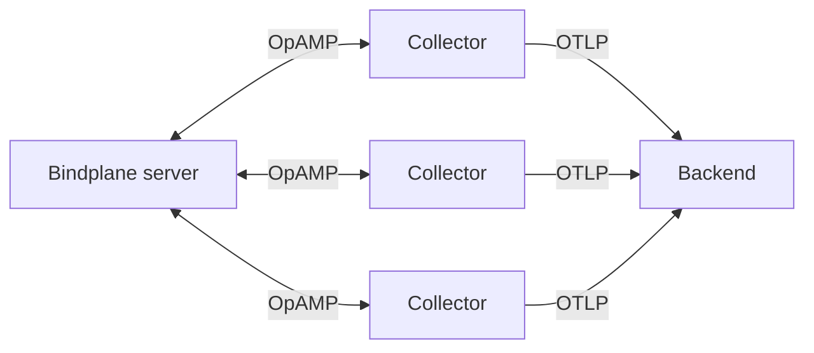

# Lab 11: Bindplane (discussion and demo)

**Time:** 5 minutes. The facilitator shows it. There are no lab files to run.

## 1. Goal

See what a finished, product-grade OpAMP control plane looks like, and compare it with the small server you built in [Lab 10](10-opamp.md).

## 2. Why it matters

In Lab 10 you edited one file and a running collector changed. That is the core idea. A real fleet needs much more:

- thousands of collectors, grouped by environment or region,
- a screen to build config without hand-writing YAML,
- safe delivery, so one bad change does not break every collector,
- login, TLS and storage.

**Bindplane** is an OpenTelemetry-native control plane built for this. It is a product, not part of the OpenTelemetry project. This lab is here to show the idea at scale, not to tell you to buy it.

## 3. How it works

Bindplane uses the same protocol as Lab 10. Each collector connects to the Bindplane server over OpAMP (a WebSocket) and receives config from it.

Telemetry does **not** pass through the Bindplane server. Collectors send it straight to your backend. The server only manages them.

Bindplane has these main ideas ([source](https://docs.bindplane.com/)):

| Concept | What it is | Lab 10 equivalent |
|---|---|---|
| **Collector** | An OpenTelemetry collector connected over OpAMP. Bindplane ships its own build, the **BDOT** collector. You can also connect a custom collector (for example from Lab 07) with the OpAMP Supervisor. | The `plain` and `agent` containers |
| **Configuration** | A versioned pipeline of sources, processors and destinations. Bindplane turns it into collector YAML. | `remote-config.yaml` |
| **Rollout** | How a new version reaches collectors, step by step. | Copying a file and hoping |
| **Edge Fleet** | A named group of collectors that share one configuration. | Not in Lab 10 |
| **Gateway** | A group of collectors that receive data from edge collectors, process it in one place, and forward it. | Not in Lab 10 |

### Rollouts

In Lab 10 your change hit every agent at once. Bindplane does not do that:

- **Standard rollout** (all editions): the new version goes to 3 collectors first. Then more follow in growing batches. If any collector reports an error, the rollout pauses.
- **Progressive rollout** (Enterprise only): you define stages by label, for example `env=staging` then `env=production`. It stops after each stage until you continue.

You can also roll back to an earlier version.

## 4. Demo (facilitator)

Show these four things in the Bindplane UI. Keep it to five minutes.

1. **The collector list.** Point out that it is the same information as the agent list in Lab 10: who is connected, and their health.
2. **A configuration.** Show sources, processors and destinations as blocks. Say: "This is the YAML from Lab 06, built with clicks."
3. **A change.** Add or remove a processor, for example a filter that drops DEBUG logs. This repeats Lab 10 in the UI.
4. **The rollout.** Start it. Show the staged delivery and the diff between the old and new version.

!!! note "Facilitator"
    Check the demo works on your account before the session. Plans and features change, and Progressive rollouts need Enterprise.

## 5. Discussion questions

1. Lab 10's server forgot every agent when it restarted. What must a real server store?
2. A rollout pauses when a collector reports an error. What could still go wrong that the collector would **not** report? (Think: valid config that drops the wrong data.)
3. Telemetry skips the Bindplane server. What is the good side of that? What happens to your collectors if the server is down?
4. You must choose between a vendor control plane and building on the OpAMP server in the OpenTelemetry repositories. What would you weigh? (Think: cost, support, lock-in, effort.)
5. When would you add a Gateway tier instead of sending from every edge collector straight to the backend?

## 6. Going further

- [Bindplane documentation](https://docs.bindplane.com/)
- [Connect collectors using the OpAMP Supervisor](https://docs.bindplane.com/how-to-guides/bring-your-own-collector/connect-opentelemetry-collectors-using-the-opamp-supervisor). It shows how to manage a custom collector from Lab 07.
- [BDOT collector on GitHub](https://github.com/observIQ/bindplane-otel-collector)
- [OpAMP specification](https://github.com/open-telemetry/opamp-spec)
